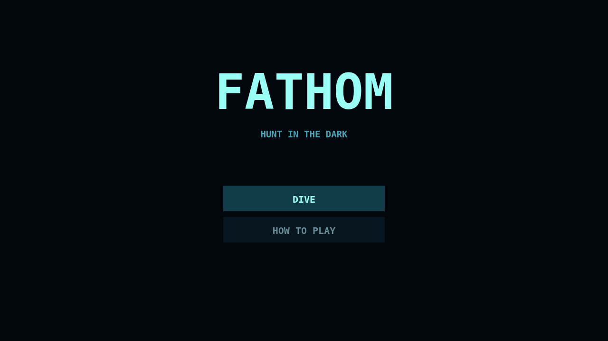
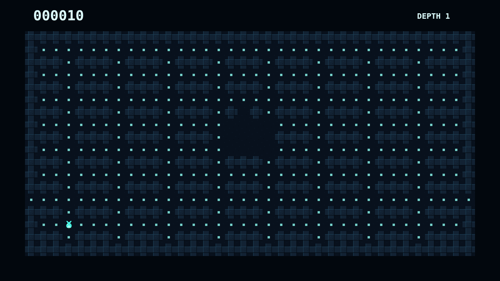

# Fathom

Slip into a trench where the map exists only as far as your glow can reach. Each plankton mote feeds your light, briefly widening the cool circle through which the remembered maze can be seen.

Sonar sketches distant corridors and danger, but sound is never free. Lanternjaw wears the same amber glimmer as harmless drifters, Gloamfin follows noise, and Flarefish turns the darkness against you in a sudden bloom.

Graze the maze clean, spend ink when a hunter closes, and descend to a denser roster below. Fathom is a tense rhythm of exploration, memory, and quick escapes.

